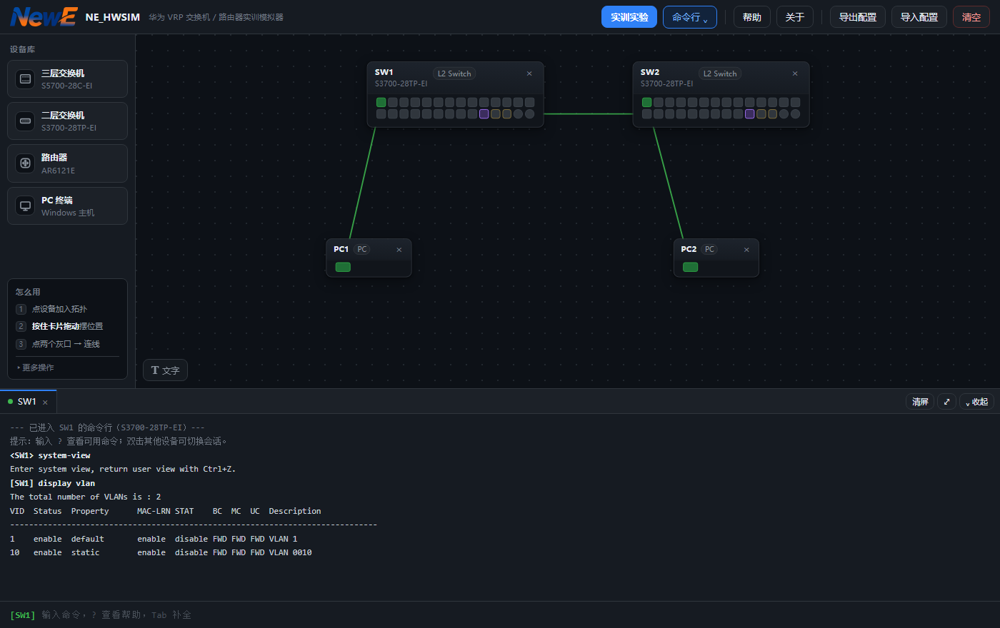
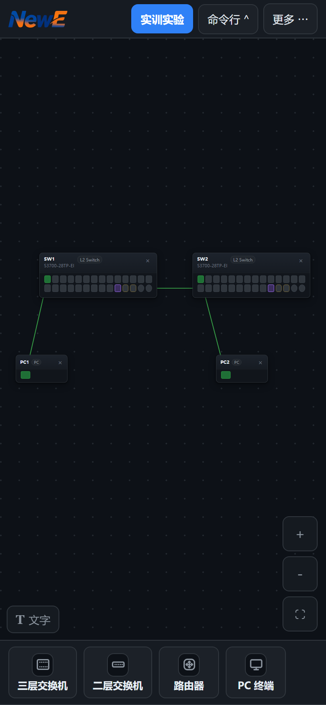

# NE_HWSIM · 华为 VRP 网络实训模拟器（单文件网页版）

**一个 HTML 文件，双击就能练华为交换机 / 路由器命令 —— 不用装 eNSP，不用装 GNS3，不联网也能用。**

> 上图就是打开后的样子：拖两台交换机、连两根线，点「实训实验」加载题目，然后在下面敲 `system-view`、`port link-type trunk` —— 和真机一个规矩。

---

## 30 秒上手

| 步骤 | 做什么 |
|---|---|
| **1** | **[点这里在线打开](https://liuyimr.github.io/NE_HWSIM/NE_HWSIM.html)**（推荐，什么都不用下） 或下载 `NE_HWSIM.html` 一个文件 |
| **2** | **双击它** —— 用 Chrome / Edge / Firefox 打开 |
| **3** | 已经自动搭好一套 VLAN 实验拓扑，点 **「开始配置」** 就能动手 |

就这三步，没有第四步。发给学生：微信、QQ、U 盘、班级群，随便怎么传都行。

> 更细的图文说明 —— 端口形状与 Combo 口、电脑/手机手势、命令速查、导入导出规则、常见问题 ——
> 见 **[使用说明.md](使用说明.md)**（纯 Markdown，GitHub 上可直接读）。

> 文件必须保留 `.html` 后缀。如果微信传输后后缀变了，改回 `.html` 即可。

---

## 这是什么

给**网络课老师**和**备考华为认证的同学**做的一个练习工具。

eNSP 要装 VirtualBox，GNS3 要配镜像，虚拟机镜像动辄几个 GB，还得看电脑配置。很多学生卡在第一步就放弃了，然后就没有然后。NE_HWSIM 的判断是：**先把门槛降到零** —— 一个 443 KB 的 HTML 文件，发过去、双击、开始敲命令，整个过程不需要任何解释。

它**不是**真机的替代品，也跑不了复杂的园区网。它解决的是一个很具体的问题：**让学生能在自己的笔记本上、离线、零安装地，把 VLAN / Trunk / OSPF / ACL / NAT 这些命令反复敲到熟。**

---

## 核心特性

- **真实的华为 VRP 命令行**：用户视图 → 系统视图 → 接口视图 → VLAN 视图 → 端口组视图 → ACL 视图 → NAT 地址池视图 → OSPF 区域视图 → RIP 视图，**一级一级进入、`quit` 一级一级退出**，和真机一个规矩
- **真实的报错风格**：敲错了会出 `^` 精确指到出错的那个词，`Unrecognized` / `Incomplete` / `Ambiguous` / `Wrong parameter` 的措辞和真机一致
- **真实的交互**：`save` 会问你 `(y/n)[n]`，再问文件名 —— 跟真机一样
- **9 个现成实训实验**：拓扑一键加载，附实验目标 + 操作提示（见下表）
- **批量配端口**：`interface range ge 0/0/1 to ge 0/0/5`、`port-group group-member ... to ...`（临时端口组）、`port-group 1`（命名端口组，写进配置）三种真机写法都有
- **拖拽搭拓扑**：4 种设备随便拖，点两个端口就完成连线；线缆颜色直接反映状态（灰＝未连线，绿＝已连通，红＝shutdown，紫＝Trunk）
- **动态路由**：`rip 1` → `version 2` → `network` 一路配上就自动学路由（按跳数收敛，Pre=100），
  两台路由器中间隔着交换机也能建邻居（互联口在同一 VLAN 即可）；
  和 OSPF 一样有 `display rip` / `display rip routing` / `display rip neighbor` 可查
- **画布上能写注释**：画布左下角 **`T 文字`** 直接放一个文字标签，拖位置、双击改字、长按/右键删除，
  跟着拓扑一起自动保存 —— 讲网络规划时可以直接标「这里 192.168.10.0/24」
- **连线可删、可改接**：点一下选中后按 `Delete`、点线中点浮现的 `×`、右键，或**双击已连线的端口**都能断开；**在连线上按住拖动就能把那一端改接到别的空闲端口**，不用先删再连（改接失败会自动回滚，不会把线弄丢）
- **手机 / 平板也能用**：窄屏自动换竖版布局（设备库搬到底部横条），所有操作都有对应的手指手势 —— 拖动设备、双指捏合缩放、长按删除、连点两下开命令行（见下）
- **导入 / 导出能搬走整张画布**：导出的 txt 开头是拓扑段（设备型号与摆放位置、每条连线、画布注释），后面是每台设备的 `running-config`。再导入回来，**设备、连线、注释、配置全部原样还原**，换台电脑接着做、交作业再改回来都行；导入结果有统计 + 逐台明细，连线没还原成功的地方会单独列出来
- **路由问题看得见**：下一跳不可达的静态路由，`display ip routing-table` 里 Flags 只有 `R` 没有 `D`，
  表下面还会单独列出来；ping 不通时原因会点名是哪台设备、缺什么路由
- **进度自动保存**：关掉浏览器再打开，拓扑和配置都还在（含画布上的文字注释）
- **单文件、零依赖**：没有后端、没有账号、不联网、不采集任何数据

---

## 手机 / 平板也能用

同一份 HTML 文件，手机上打开就会自动切成竖版：设备库从左侧栏搬到底部一条横条，
画布占满整个宽度，顶栏只留「实训实验 / 命令行 / 更多 ⋯」。

**功能一个不少，只是手势不一样：**

| 操作 | 电脑 | 手机 / 平板 |
|---|---|---|
| 移动设备 | 按住卡片拖动 | 手指按住卡片拖动 |
| 平移画布 | 空白处按住拖动 | 单指拖动空白处 |
| 缩放 | `Ctrl` + 滚轮 | **双指捏合**；或右下角的 `＋` / `－` / `⛶` |
| 连线 | 点两个灰口 | 轻点两个灰口 |
| 打开命令行 | 双击设备 | **连点两下**设备 |
| 删除设备 | 右键，或选中按 `Delete` | **长按**卡片；或点右上角 `×` |
| 删除连线 | 点选中按 `Delete` / 点中点 `×` / 右键 | 轻点选中 → 点中点 `×`；或**连点两下**端口；或**长按**连线 |
| 改接 | 在连线上按住拖动 | 手指按住连线拖动 |
| 看端口详情 | 鼠标悬停 | **长按**端口 |

卡片和端口在手机上也自动放大一档（端口高度 14px → 19px），方便手指点按。
横屏手机会把顶栏和设备条压扁，把高度让给画布。

> 手机上不需要装 App —— 把这个 HTML 文件传到手机（微信 / QQ / 网盘都行），用浏览器打开即可。

---

## 内置 14 个实训实验

点顶部 **「实训实验」** 按钮，选一个直接加载（会自动搭好拓扑、连好线）。

| # | 实验 | 主要练什么 | 难度 |
|---|---|---|---|
| 一 | VLAN 基础与端口划分 | `vlan` · `port link-type access` · `port default vlan` | 基础 |
| 二 | Trunk 跨交换机 VLAN | `port link-type trunk` · `port trunk allow-pass vlan` | 基础 |
| 三 | 三层交换实现 VLAN 间互通 | `interface Vlanif` · `ip address` | 基础 |
| 三·补 | **单臂路由（子接口）** | `interface GE0/0/0.10` · `dot1q termination vid` · `arp broadcast enable` | 进阶 |
| 四 | 静态路由实现跨网段互通 | `ip route-static` | 基础 |
| 五 | OSPF 单区域动态路由 | `ospf 1` · `area 0` · `network` | 基础 |
| 五·补 | **RIP 动态路由** | `rip 1` · `version 2` · `network` · `display rip neighbor` | 进阶 |
| 六 | DHCP 自动分配地址 | `dhcp enable` · `ip pool` · `dhcp select global` | 基础 |
| 六·补 | **DHCP 中继** | `dhcp select relay` · `dhcp relay server-ip` | 进阶 |
| 七 | **ACL 访问控制** | `acl number 3000` · `rule deny ip source ... destination ...` · `traffic-filter inbound` | 进阶 |
| 八 | **NAT 网络地址转换** | `acl number 2000` · `nat outbound` · `nat address-group` | 进阶 |
| 八·补 | **NAT Server 端口映射** | `nat server global ... inside ...` · `display nat server` | 进阶 |
| 九 | **设备远程管理** | `telnet server enable` · `aaa` · `local-user` · `user-interface vty` | 进阶 |
| 十 | **IPv6 基础** | `ipv6` · `ipv6 address` · `ipv6 route-static` · `ping ipv6` | 进阶 |

每个实验加载后都会弹出**实验目标**和**操作提示**，学生照着做即可；做完点「导出配置」把 txt 交上来。

> 实验加载的是**拓扑**（设备 + 连线），**不包含配置** —— 配置要学生自己敲，这正是练习的目的。
> 实验七预置了三个 Vlanif 网关，实验八预置了全部接口地址，让学生专注在当堂知识点上。

---

## 和 eNSP / GNS3 / Packet Tracer 比

| | **NE_HWSIM** | eNSP | GNS3 | Cisco Packet Tracer |
|---|---|---|---|---|
| 安装 | **双击 HTML，零安装** | 需装 VirtualBox + eNSP | 需装虚拟机 + 导入镜像 | 需注册 Cisco 账号 |
| 体积 | **443 KB** | 数 GB | 数 GB | 数百 MB |
| 联网 | **可完全离线** | 首次需下载镜像 | 需下载镜像 | 需登录 |
| 命令语法 | 华为 VRP | 华为 VRP | 多厂商 | Cisco IOS |
| 上手门槛 | **极低** | 中（装环境容易失败） | 高 | 中 |
| 复杂园区网 | 做不了 | 支持 | 支持 | 支持 |

一句话：**eNSP 适合做完整实验，NE_HWSIM 适合"今天就要练这几条命令"**。两者不冲突，可以配合用。

---

## 支持的命令与特性范围

**二层**：VLAN（含 `vlan batch` / `undo vlan batch`）、Access / Trunk / Hybrid 端口、MAC 地址学习表、STP / RSTP 破环、链路聚合 Eth-Trunk、端口安全 Port-Security

**IPv6**：地址配置、ND 邻居、IPv6 直连与静态路由（`ipv6` 全局开关、`ping ipv6`、`display ipv6 …`）

**设备管理**：Telnet 服务、AAA 本地用户（`local-user`）、VTY 认证（`user-interface vty 0 4`），一台设备可 `telnet` 登录另一台

**三层**：直连路由、静态路由（下一跳 / 出接口两种写法，支持**路由递归**）、**RIP v1/v2**（版本必须两端一致）、OSPF 单区域、最长前缀匹配、ARP、Vlanif 三层接口、**子接口 / 单臂路由**（`dot1q termination vid` + `arp broadcast enable`）

**服务与安全**：DHCP 服务器（地址池 / 网关）与 **DHCP 中继**（`dhcp select relay` + `dhcp relay server-ip`）、**ACL**（基本 2000-2999 / 高级 3000-3999，支持源 + 目的 + 协议匹配，含**隐含 `deny all`**，可绑物理口、端口组或 Vlanif，入向 / 出向都生效）、**NAT**（Easy IP、`nat address-group` 地址池、**NAT Server 端口映射**）

**`display` 系列**：`display vlan` · `display interface` · `display port vlan` · `display ip interface brief` · `display ip routing-table` · `display mac-address` · `display arp` · `display stp brief` · `display ospf peer brief` · `display ospf interface` · `display acl` · `display nat session all` · `display rip` · `display rip routing` · `display rip neighbor` · `display port-group all` · `display eth-trunk` · `display ip pool` · `display this`（任意视图可用）· `display current-configuration`

**设备型号**：**S5700-28C-EI** 三层交换机（24×GE 电口 `GE0/0/1~24` + 4×GE 插卡光口 `GE0/1/1~4`）·
**S3700-28TP-EI** 二层交换机（24×10/100 电口 `E0/0/1~24` + 4×GE 上行：`GE0/0/1-2` **光电复用**、`GE0/0/3-4` 纯光口）·
**AR6121E** 路由器（`GE0/0/0`/`0/0/1` **GE Combo WAN** + `10GE0/0/0` + `GE0/0/2~9` 电口 LAN + `GE0/0/10` **GE Combo LAN**，共 12 口）· PC

接口命名按真机：中间那段是**槽位**（`GE0/0/1` 板载、`GE0/1/1` 插卡）；交换机物理口默认二层、路由器以太口默认三层，
两种口用 `portswitch` / `undo portswitch` 互相切换，命令不通用（用错会报错并给提示）。
**光电复用（Combo）口同时支持电口与光口**：接电就用铜、接光就用纤，二选一，画布上画成圆角方块。

**运行环境**：电脑上用 **Chrome / Edge 87+**（Win7 最高可装 109）、Firefox 84+、Safari 14.1+ 双击打开即可，
不需要服务器；手机 / 平板上同样一个文件，用系统浏览器打开就行（iOS Safari 14+ / Android Chrome 87+）；
窄屏（≤760px）自动切竖版布局，横屏手机自动压缩顶栏把高度让给画布。

> **360 / QQ / 搜狗这类双核浏览器请用「极速模式」**（地址栏右侧的闪电图标）。兼容模式是 IE 内核，跑不了。
> 内核不够时页面顶部会出一条黄色提示条，说明缺什么 —— 不会让你对着一片空白猜。

---

## 常见问题

**Q：要联网吗？会偷偷上传我的东西吗？**
A：不需要联网，可以完全离线运行。整个模拟器就是一个 HTML 文件，**没有任何网络请求**、没有后端、没有账号、不采集任何数据。你可以断网打开它验证。

**Q：导出的文件能再读回来吗？**
A：能，而且是**整张画布一起搬**：设备、摆放位置、连线、画布注释、每台设备的配置都会还原（文件开头的 `@topology` 段就是干这个的）。删掉那一段，导入时就只还原配置。
重复导入不会翻倍 —— 同名设备复用、已连好的线跳过。

**Q：我的配置会丢吗？**
A：会自动保存在**你自己浏览器**的本地存储里，同一台电脑、同一个浏览器再次打开会自动恢复。换电脑、换浏览器、清浏览器数据会丢。要长期保存请点「导出配置」。

**Q：路由配了但 ping 不通，怎么查？**
A：三步就能定位：

1. `display ip routing-table` —— 目标网段在不在？下一跳那一行 **Flags 有没有 `D`**？
   只有 `R` 没有 `D`，说明这条路由的**下一跳当前不可达**（表下面会单独列出来）。
2. `ping 下一跳地址` —— 互联口通不通？两端地址是否同一网段、端口有没有连线、有没有 `shutdown`。
3. 两台设备**都要有路由**：正向要有，回程方向也要有（真实网络必须双向可达）。

> ping 失败时会直接点名是哪台设备断的，例如：
> `失败原因：R2 上没有到达 192.168.2.10 的路由（检查静态 / 动态路由是否配全，回程方向也要配）`。

**Q：设备能改名吗？PC 行不行？**
A：都能。交换机 / 路由器在系统视图下 `sysname 新名字`；**PC 没有 `system-view`，直接敲 `sysname 新名字`**，
卡片标题和提示符会一起变（比如把 PC1 改成 `Server-01`）。

**Q：怎么在拓扑图上写注释？**
A：点画布左下角的 **`T 文字`**，直接打字（支持多行）。拖动挪位置、双击改字、右键（电脑）或长按（手机）删除。
注释跟着拓扑自动保存。

**Q：和真机差多少？能替代 eNSP 吗？**
A：命令行风格、视图层级、报错措辞、`save` 交互都尽量贴近真机，但**它是教学模拟器，不是仿真平台** —— 不做报文的逐字节仿真，也不支持复杂特性（VRRP、MSTP、BGP 等）。适合练命令和验证配置思路，不适合做毕业设计级别的复杂组网；想练完整园区网请用 eNSP。

**Q：为什么设备 / 命令比真机少？**
A：刻意的。功能越少，学生越不容易被无关的东西分散注意力，文件也才能这么小。

**Q：可以拿去商用 / 印在教材里 / 发给培训班的学员吗？**
A：可以。**MIT 许可证**，随便用，商用也行，改了也不用告诉我。详见 [LICENSE](LICENSE)。

**Q：支持 Cisco 命令吗？**
A：不支持，只做华为 VRP 语法。想练 Cisco 请用 Packet Tracer。

**Q：手机上能用吗？**
A：能。把同一个 HTML 文件传到手机（微信 / QQ / 网盘都行），用手机浏览器打开就会自动切成竖版：
设备库在屏幕底部、画布占满宽度。手指拖动设备、双指捏合缩放、连点两下开命令行、长按删除设备、
长按端口看详情 —— 功能一个不少，只是手势不一样（见上面「手机 / 平板也能用」的对照表）。

**Q：我怎么知道手上这个文件是哪个版本？**
A：点顶栏 **「关于」**，里面写着版本号；用记事本打开文件，**开头的注释里也有**（比如 `版本：v1.6.5`）。下载单个 HTML 文件就能自带版本信息，不用去比对文件大小。

---

## 给老师

1. 把 `NE_HWSIM.html`（或在线版链接）发到班级群。
2. 学生存到桌面，双击打开。
3. 想做哪个实验，点「实训实验」加载。
4. 学生做完点「导出配置」，把 txt 交上来 —— 每条命令配得对不对一目了然。
5. 想检查某个学生的配置：在**自己的模拟器**里点「导入配置」选中那个 txt 就能载入，直接看他配出来的网络能不能通。

> 机房不方便群发文件的话，放到校内共享盘 / 学习通 / 钉钉群文件也行，下载后双击即用。整个模拟器就一个文件，放 U 盘拷走也行。

---

## 最近更新

**v1.6.5**

- **清空拓扑时自动收起命令行面板**。以前点「清空」后，下方命令行还占着半屏、里面是已经不存在设备的会话。
- **展开命令行不再把设备藏起来**。收起面板时加载实验，视图是按大画布适配的；一展开面板，
  画布矮了 336px，最下面那排设备就跑到面板后面去了 —— 看起来像「设备不见了」。
  现在面板开合后会检查一遍，过半数设备被挤出可视区就自动重新适应（只是放大看某一台时不会被强行拉回全景）。
- **设备卡片有层次了**：卡片头比机身亮一档、端口区做成内嵌面板（底色压暗 + 一道顶光），
  24 口交换机不再糊成一整块。
- **左栏「怎么用」重做**：8 行小字换成三步编号卡片，双击 / 删除 / 连错 / 手机手势收进「更多操作」折叠项；
  内容放不下时侧栏自己滚动，不会溢到画布上。

**v1.6.4（界面整理）**

- **图标换成自绘的线性 SVG**。原来设备库用的是 emoji（🔀📡💻）—— 同一个 emoji 在 Windows 是彩色平面、
  在 Android / iOS 又是另一套画法，跟界面的冷灰风格完全不是一个语言。现在四个设备（三层交换 / 二层交换 /
  路由器 / PC）和八个菜单项都用 16×16 线性图标，颜色跟着字色走，与 NewE 标识同一套内联 `<symbol>` 做法，
  不引入任何外部图标库。
- **尺度收口**：圆角从 10 种零散取值归到 4 档（4 / 8 / 12 / 胶囊），字号从 10 档（含 11.5、12.5 这种
  半像素）归到 7 档，过渡统一成 .12s / .2s 两档，阴影统一成「卡片 / 浮层」两级。
- **顶栏按钮分了三档**：`实训实验` 是主操作（实心蓝），导出/导入是工具（描边），
  清空是破坏性操作（红字红边），帮助/关于弱化成无边框；两组之间加了分隔线。
  以前七个按钮长一个样，反而让「命令行」开关抢了视觉重心。
- **连线的两端加了小圆点**，交叉时更容易看出哪条线接到哪儿；选中时圆点跟着变蓝。
- 手机端：顶栏标识缩小一档，底部设备条留出下边距（并适配刘海屏安全区），卡片不再贴着屏幕边缘。

**v1.6.3（旧电脑兼容）**

- **老浏览器不再整页空白**。原来 IPv6 模块里写了 BigInt 字面量（`0n` / `16n`），
  在 Chromium 67 以下的浏览器里这是**语法错误**，整个脚本不执行、页面全白 —— 现在改成 `BigInt(...)` 调用，
  没有 BigInt 的环境里 IPv6 自动降级为「不可用」，其它功能照常。
- **布局兜底**：`inset:0` 拆成 `top/right/bottom/left`（Chromium 87 才有 `inset`）、
  终端面板的 `dvh` 补了 `vh`、flex 的 `gap` 在旧内核下用 margin 顶上（Chromium 84 才有 flex gap）。
  这样 360 安全浏览器 v12/v13（内核 78/86）这类环境不会再把按钮挤成一团、画布也不会塌。
- **补了 `padStart` / `padEnd`**（Chromium 57 才有），表格类回显在旧内核上不再报错。
- **新增旧内核提示条**：内核不够时页面顶部出一条黄条，写明缺什么能力、怎么换浏览器，
  不再让人以为程序坏了。它用最保守的语法写，即使其它脚本全崩也能显示出来。
- README 与使用说明写清了最低版本：**Chrome / Edge 87+**（Win7 最高 109），
  双核浏览器请用**极速模式**。
- **顺手加固了「设备/连线看不见」的老问题**（这个以前偶发，很难复现）：
  存档或导入的 txt 里坐标缺失时，卡片会被排到合法位置，而不是因为 `left:NaNpx` 被浏览器整条忽略；
  上次的平移把拓扑甩到视口外（换了屏幕尺寸最常见）时，打开会自动拉回可视范围；
  连线的端点算不出有效坐标时也不会整条消失。

**v1.6.2**

- **修掉「点设备卡片右上角的 × 删不掉」**：设备卡片头部绑了拖动（用 Pointer Capture 接管指针），
  × 又正好在头部里面 —— 指针被头部抢走后，浏览器把 `click` 派给了头部，× 根本收不到。
  现在 × 自己先拦下 `pointerdown`，左键点一下就删（右键删除一直是好的，所以这个 bug 才藏了这么久）。
- **桌面端不再误触长按删除**：长按（0.5 秒）删除本来是给触摸端补「没有右键」的，
  但鼠标按住不动也会触发，弹「确定删除设备吗」。现在长按只在触摸 / 触控笔下生效；
  桌面要删设备仍然是点 ×、右键、或选中后按 `Delete` 三条路。

**v1.6.1**

- **光电复用口（Combo）**：同一端口既能插网线也能插光模块，**接什么用什么** —— 接到电口按铜缆通，接到光口按光纤通，
  端口上会显示当前用的是哪一路。三台设备按真机给出：S3700-28TP-EI 两个（`GE0/0/1~2`）、AR6121E 三个
  （`GE0/0/0`、`GE0/0/1`、`GE0/0/10`），S5700-28C-EI 没有。
  `display interface` 里能看到 `COMBO AUTO` / `COMBO AUTO(COPPER)` / `COMBO AUTO(FIBER)`，
  画布上 Combo 口用**圆角矩形**画，与圆形光口、方形电口一眼区分。
- **介质互斥如实模拟**：纯光口接纯电口仍然连不上（提示换同类型端口或改用 Combo 口），Combo 则两边都收；
  一个 Combo 口只能接一条线，光、电二选一。
- 端口悬停提示补上「介质」一行（电口 / 光口 / 光电复用），接线前就能看清该用哪种线。
- 旧配置文件里 S3700 电口写成 `GigabitEthernet` 的，导入时自动按新型号换算成 `Ethernet0/0/N`，
  1~4 号再按对端是电口还是光口判断该落到哪一组口上。

**v1.6.0**

- **IPv6 基础**：`ipv6` 全局开关 → 接口 `ipv6 address` → `ipv6 route-static` 静态路由；
  `ping ipv6`、`display ipv6 interface brief` / `routing-table` / `neighbors`（ND 邻居表）。
  地址会做规范化（`2001:0db8:0000::1` 与 `2001:db8::1` 视为同一个）。**忘了全局 `ipv6` 地址就不生效**，
  模拟器会直接提示 —— 这是 IPv6 最常见的坑。
- **DHCP 中继**：`dhcp select relay` + `dhcp relay server-ip`，服务器在另一个网段也能分配地址。
  中继没开 `dhcp enable`、服务器缺回程路由，都会给出明确原因。
- **NAT Server 端口映射**：`nat server global <公网IP> inside <私网IP>`（可带协议与端口），
  外网访问公网地址会被转到内网服务器；`display nat server` / `display nat session all` 可查。
- **设备管理与 Telnet 登录**：`telnet server enable`、`aaa` + `local-user`、`user-interface vty 0 4` +
  `authentication-mode`；从一台设备 `telnet <IP>` 会走真实的用户名 / 密码交互，登录后终端切到对端。
- 新增 4 个实验：**六·补 DHCP 中继**、**八·补 NAT Server**、**九 设备远程管理**、**十 IPv6 基础**。
- 修掉导出导入时 PC 的 IPv6 地址与网关丢失的问题。
- **S3700 补齐到真机的 28 口**：24 个百兆电口 `Ethernet0/0/1~24` + 4 个千兆上行口
  `GigabitEthernet0/0/1~4`（两套编号各自从 1 起，`E0/0/1` 与 `GE0/0/1` 是两个口）。
  补全 `E` / `Eth` / `Ethernet` 前缀与批量写法，二层交换机也会拒绝子接口。
- **S3700 支持 Vlanif 管理地址**：可以 `interface Vlanif1` 配管理 IP，被 PC ping 通、被 telnet 登录，
  但仍不做 VLAN 间路由（不会因为配了 Vlanif 就变成网关）。
- **S5700 型号纠正为 S5700-28C-EI、路由器纠正为 AR6121E**，端口数量与类型按真机重建：
  S5700 的 4 个光口在插卡槽（`GE0/1/1~4`），AR6121E 是 2×GE Combo WAN + 1×10GE + 9×GE LAN。
- **接口二层/三层语义按真机**：路由器以太口默认三层（可直接 `ip address`），交换机物理口默认二层
  （要配 IP 先 `undo portswitch`）；三层口上敲 `port link-type` 会报错并提示先 `portswitch`。

**v1.5.0**

- **新增单臂路由（Router-on-a-Stick）**：路由器上的子接口 —— `interface GigabitEthernet0/0/0.10` →
  `dot1q termination vid 10` → `ip address 192.168.10.254 24` → `arp broadcast enable`，
  一条链路给多个 VLAN 当网关。两个硬性前提都如实模拟：**没绑 `dot1q termination vid` 或没开
  `arp broadcast enable` 就是不通**，失败原因直接点名缺哪一条；父端口 shutdown 时子接口跟着失效。
  新增 **实验三·补 · 单臂路由**，和实验三的三层交换 Vlanif 对照着看。
- **子接口进配置**：`running-config`、`display this`、`display ip interface brief` 都包含子接口，
  导出导入、保存恢复能原样还原。
- **TAB 补全**：子接口视图里的 `dot1q` / `arp broadcast enable` / `ip address` 等。
- 修掉 `ping` 同网段时的一条误判：目的地址正好是某台设备的子接口、而它的父端口被 shutdown 时，
  现在直接点出是哪个端口，不再让人去猜 VLAN。

**v1.4.0**

- **RIP 动态路由**：`rip 1` → `version 2` → `network`，`silent-interface`、`undo rip` 都有；
  和真机一样**缺省是 version 1**，两端版本不一致就建不起邻居（`display rip neighbor` 会直接指出）；邻接按**二层可达**判定，中间隔着交换机也能建立；
  `display rip` / `display rip routing` / `display rip neighbor` 可查邻居与学到的路由；
  另附**实验五·补 · RIP 动态路由**（同一个拓扑，把静态路由换成 RIP 对比效果）
- **静态路由更接近真机**：支持**路由递归**（下一跳不在直连网段时按路由表再查），
  支持把下一跳写成出接口（`ip route-static 192.168.2.0 24 GigabitEthernet0/0/0`）
- **路由问题不再「看着是好的」**：下一跳不可达的静态路由，路由表 Flags 只有 `R` 没有 `D`，
  表下面单独列出并说明原因；ping 不通时失败原因**点名到设备**（`R2 上没有到达 … 的路由`），不再只说「没有路由」
- **OSPF 少了两个坑**：`network` 把子网掩码误写成 `255.255.255.0` 会被自动换算成反掩码并提示
  （原来会静默失效、邻居永远起不来）；**没有邻居时 `display ospf peer` 会逐条列出原因**
  （对端没开 OSPF / 接口没被通告 / 区域不同 / 网段不一致 / 报文过不去）
- **PC 上 ping 不通、路由器上却通？** PC 不是路由器，它没有路由表，跨网段全靠**默认网关**。
  现在 `ping` 的失败原因会直接说清是哪一种：没配网关 / 网关不在本网段 / 这个网关在整个拓扑里没有设备配置 /
  网关口是 shutdown / 同网段直连的 VLAN 问题 —— 不会再把你引去「检查静态 / 动态路由」。
  `ip`、`ipconfig`、`dhcp`、`display ip pool` 在配置时就会提示（DHCP 地址池漏 `gateway-list` 是最常见的坑）
- **导入 / 导出加强**：导出文件里带一段 `@topology`（设备型号/坐标、连线、注释），导入时**先把整张画布还原**（同名设备复用、已连好的线跳过，重复导入不会翻倍），再逐台重放配置；导入报告新增「新建设备 / 还原连线 / 恢复注释」统计和连线异常清单。同时修掉三处配置漏导出：**shutdown 的端口**、**STP 全局参数**、`vlan batch` 里多余的 VLAN 1
- **画布文字标签**：左下角 **`T 文字`** 直接在拓扑上写注释，可拖动、双击改字、长按或右键删除，随拓扑自动保存
- **PC 可以改名了**：PC 的终端里直接 `sysname 新名字`（原来 PC 只认 `ipconfig` / `ip` / `ping` 那几条，改名无处下手）
- 修正 Vlanif 之间 OSPF/RIP 邻接的判定（原来两台交换机之间只要有一根线就可能被判成邻居）
- 修掉「**T 文字**」点不出来、文字标签拖不动：画布在判断目标之前就抢走了指针，导致画布里的按钮收不到点击、
  标签收不到移动事件（这条以前的测试用合成事件测不出来，现改为真实鼠标 / 触摸事件回归）

**v1.3.0**

- **手机 / 平板适配** —— 之前在手机上**根本拖不动设备**（界面用的是鼠标事件，
  而手机上抬手前不会连续触发 `mousemove`）。现在所有交互统一走 Pointer Events，
  触摸端补齐了缺失的能力：**双指捏合缩放**、**连点两下开命令行**、**长按删除**（代替右键）、
  **长按端口看详情**（触摸屏没有"鼠标悬停"）
- **窄屏自动切竖版布局**：设备库从左侧栏搬到**底部一条横条**，画布占满整个宽度，
  顶栏 7 个按钮收成「实训实验 / 命令行 / 更多 ⋯」；命令行输入框字号加大
  （否则 iOS 聚焦时会自动放大整页），弹窗铺满整屏；卡片与端口自动放大一档，方便手指点按
- 画布右下角新增 **＋ / － / ⛶** 缩放按钮（只在触摸设备显示，桌面保持原样，有滚轮就够）
- 修掉一个潜藏的布局问题：**顶栏内容一旦比屏幕宽，手机浏览器会把整个视口缩小放大，
  导致界面全乱**。窄屏隐藏品牌文字后恢复正常
- 顺带把卡片几何统一成一组 CSS 变量（原来 JS 和 CSS 各写一份，改一处连线就会偏离端口中心）

**v1.2.0**

- **连线可以删除和改接了** —— 之前连错了只能把设备删掉重来。现在：
  点一下选中（按 `Delete`）、点线中点的 `×`、右键、**双击已连线的端口**，四种方式都能断开；
  **在线上按住拖动可以直接把那一端改接到别的空闲端口**，改接失败会自动回滚
- 顶栏新增 **「关于」** 按钮：版本号、作者与联系方式、许可协议、在线版与源码链接
- **产物自带版本号**：构建时把版本写进文件头的注释，所以发出去的单个 HTML 本身就能看出是第几版
- 命令行输入框里的 `Delete` / `Backspace` 不再误删画布上的设备或连线

**v1.1.1**

- 加入 **NewE 官方标识**，出现在顶栏、空画布和弹窗标题栏
- 标识是**矢量重绘并内联进 HTML** 的（不是外链图片，也不是内嵌位图）—— 因此任何缩放都清晰，
  且「单文件、零外部依赖」这条特性没有被破坏

**v1.1.0**

- 新增两个实验：**实验七 · ACL 访问控制**、**实验八 · NAT 网络地址转换**
- 新增 **批量配端口**：`interface range` / `port-group group-member` / `port-group <名字>`
- ACL 补全：源 + 目的 + 协议匹配、**隐含 `deny all`**、`traffic-filter` 出方向、可绑 Vlanif
- 新增 **NAT**：Easy IP、`nat address-group` 地址池、`display nat session all`
- 新增 **「导入配置」**（导出的 txt 可读回，缺失设备按型号自动新建）
- 命令行面板可**展开 / 收起**（顶栏按钮、面板按钮、快捷键 `Ctrl` + 反引号键）
- PC 卡片尺寸收紧（260×97 → 126×57）；修正连线端点长期存在的 1px 偏移

**v1.0.0** —— 首个公开版本

---

## 反馈与交流

- 发现 Bug 或有建议，欢迎开 [Issue](../../issues)
- 教学场景的需求（比如想要某个特定实验、想改题目）也欢迎提出来

---

## 关于

**新易科技工作室 NewE** · 福州
作者：Liuyi · yimr@sohu.com

做工业自动控制与楼宇智能化的，这个是给网络教学做的小工具。

> 程序里点顶栏 **「关于」** 也能看到版本号、作者与许可信息。当前版本 **v1.6.5**。

---

## 许可

MIT License —— 随便用，商用也行，改了也不用说。详见 [LICENSE](LICENSE)。

简单说就是：**你可以拿去发给你的学生、你的培训班、你的同事，不用问我。**

---

## 免责声明

本项目为**非官方**教学演示工具，与华为技术有限公司（Huawei Technologies Co., Ltd.）
**无任何关联**，未获得其任何形式的授权、赞助或背书。

"Huawei"、"HUAWEI"、"VRP"、"Versatile Routing Platform"、"eNSP" 等为其各自权利人的商标或注册商标。
本项目中出现这些名称，**仅用于说明模拟器所兼容 / 模仿的命令语法风格**（描述性合理使用）。

模拟器的命令回显（例如 `display version` 的输出格式）为**自行编写的模拟内容**，
不包含华为公司的任何源代码、固件、文档或二进制文件。

---

## English

**NE_HWSIM — a Huawei VRP network lab simulator that fits in one HTML file.**

A single 443 KB HTML file. Double-click it and you get a drag-and-drop network topology builder plus a
faithful Huawei VRP CLI (user view → system view → interface view → VLAN view → port-group view → ACL view
→ NAT address-pool view → OSPF area view → RIP view → sub-interface view), with authentic `^` error markers and `save` interaction.

- **No installation, no backend, no account, works fully offline** — a lightweight alternative to eNSP / GNS3
  when you just need to practise Huawei CLI commands.
- **14 built-in hands-on labs** for HCIA / HCIP practice: VLAN, Trunk, inter-VLAN routing, **router-on-a-stick**
  (sub-interfaces), static routing, OSPF, **RIP**, DHCP (+ **relay**), **ACL**, **NAT** (+ **NAT Server**),
  **Telnet / AAA**, and **IPv6**.
- Batch port configuration (`interface range`, `port-group`), config export / import, auto-save to browser storage.
- **Cables can be deleted or re-plugged** — click to select and press `Delete`, click the `×` on the cable,
  right-click, or double-click a connected port; or just **drag a cable end onto another free port** to re-route it.
- **Works on phones and tablets too** — the same single HTML file. On a narrow screen the layout switches
  to portrait (device palette moves to a bottom strip), and every action has a touch gesture: drag devices,
  pinch to zoom, double-tap to open the CLI, long-press to delete.
- **RIP v1/v2** (matching version required on both ends) and **OSPF** dynamic routing, static routes with route recursion, and canvas text notes
  (`T` button) for annotating a topology.
- Devices: **S5700-28C-EI** L3 switch (24×GE `GE0/0/1~24` + 4×GE card SFP `GE0/1/1~4`), **S3700-28TP-EI**
  L2 switch (24×10/100 `E0/0/1~24` + 4×GE uplinks `GE0/0/1~4`; Vlanif as management address only),
  **AR6121E** router (2×GE Combo WAN + 1×10GE + 9×GE LAN), PC. Port names follow the real
  unit/slot/port scheme; L2/L3 port semantics match real devices (`portswitch` / `undo portswitch`).

**Try it online:** <https://liuyimr.github.io/NE_HWSIM/NE_HWSIM.html> ·
**Download:** [`NE_HWSIM.html`](NE_HWSIM.html) — that single file is the whole program.

Licensed under MIT. Made by [NewE](mailto:yimr@sohu.com) (Fuzhou, China).
Not affiliated with Huawei Technologies Co., Ltd. in any way.
